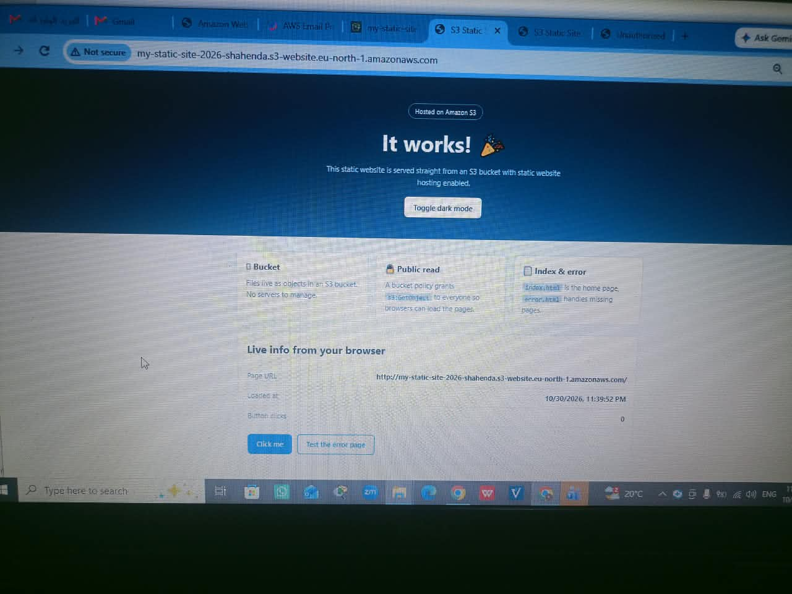
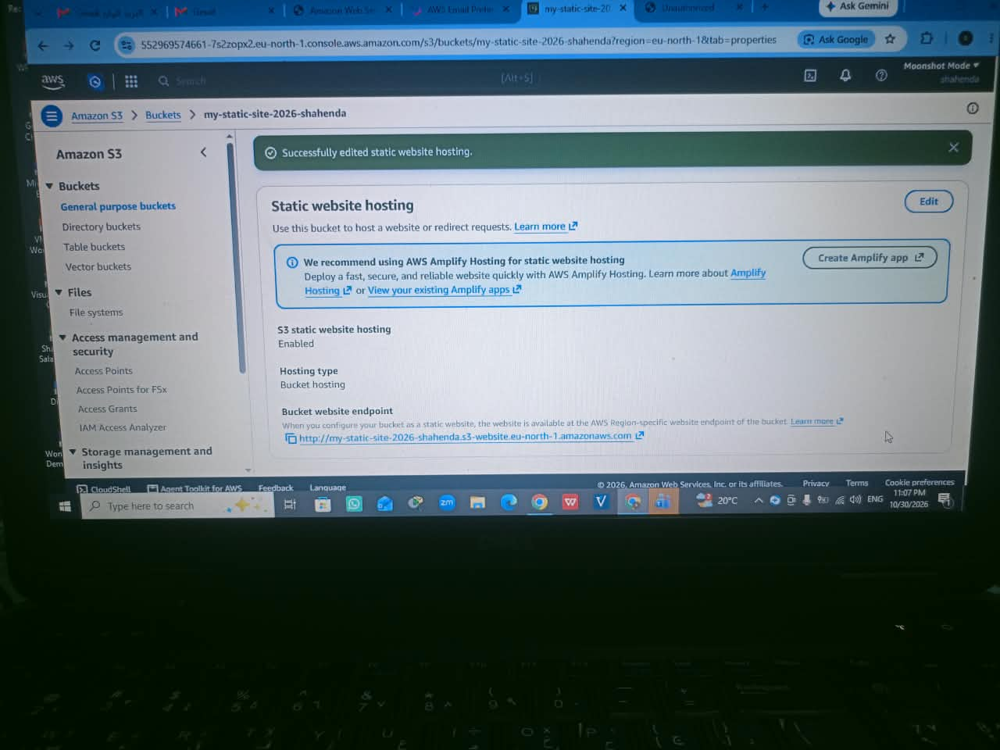

# Static Website Hosting on Amazon S3

A static website hosted on Amazon S3 with no servers to manage,
built as part of my AWS Cloud Architecting course.

## What I built
- An S3 bucket configured for static website hosting
- A home page (`index.html`) with CSS and JavaScript
- A custom 404 page (`error.html`)
- A bucket policy that allows public read access

## Screenshots

## Steps
1. **Create the bucket:** Amazon S3 > Create bucket, with a globally unique, lowercase name.
2. **Allow public access:** Turned off "Block all public access" on the bucket.
3. **Upload the files:** `index.html`, `error.html`, and the `assets/` folder (`style.css`, `app.js`).
4. **Enable static website hosting:** Properties > Static website hosting > Enable, with `index.html` as the index document and `error.html` as the error document.
5. **Add a bucket policy:** Permissions > Bucket policy (see `bucket-policy.json`). It grants `s3:GetObject` to everyone.
6. **Test:** Opened the bucket website endpoint and the 404 page.

## Bucket policy
Allows read-only access (`s3:GetObject`) to the objects in the bucket.
No write or delete permissions are granted.

## Challenges and fixes
- **403 Forbidden:** caused by Block Public Access being on and the bucket policy missing. Fixed by turning it off and adding the policy.
- **Page without styling:** `style.css` and `app.js` were uploaded to the root instead of the `assets/` folder. Fixed by uploading the folder with its structure.

## What I learned
- S3 is private by default, and how Block Public Access works
- Writing a bucket policy with the Least Privilege principle
- Difference between the index document and the error document
- Why static hosting needs no servers and is low cost

## Cleanup
Emptied and deleted the bucket after finishing to avoid charges.
